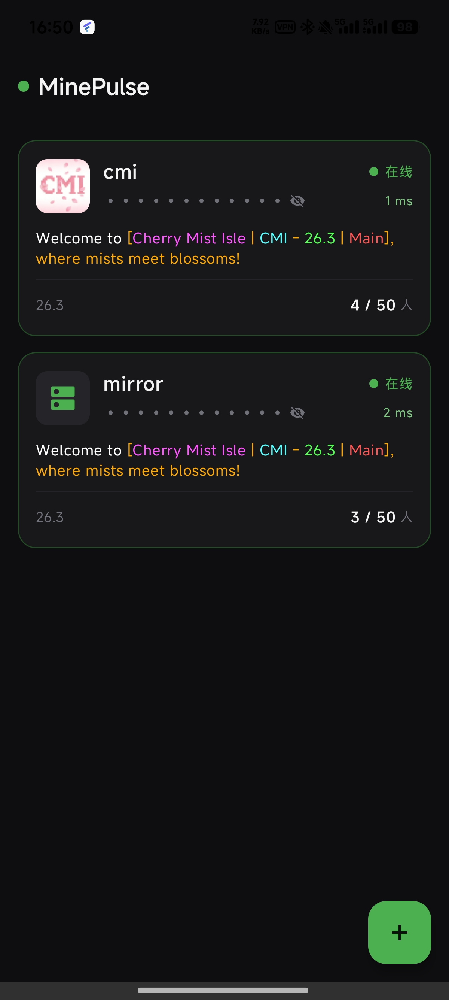
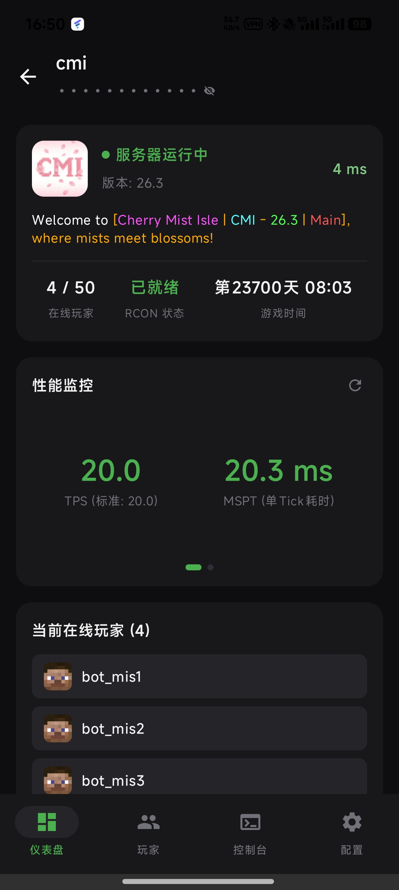
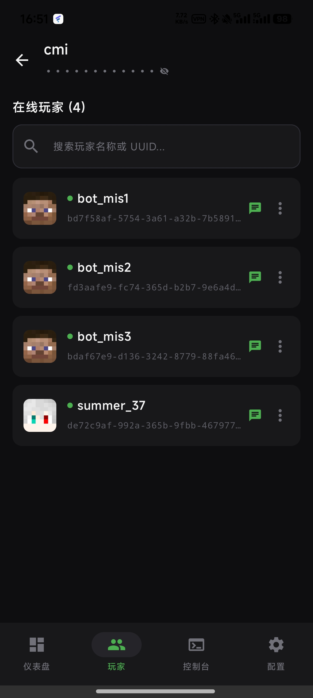
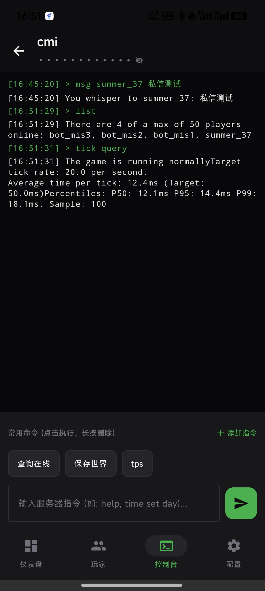

<div align="center">
  
  <h1>MinePulse</h1>
  <p><b>轻量、优雅且原生的 Android 端 Minecraft 服务器状态监控与 RCON 掌上管理工具</b></p>
  <p>
    
    
    
    
  </p>
</div>

---

## 📖 简介

**MinePulse** 是一款专为 Minecraft 服主及运维玩家打造的原生 Android 应用。采用 **Kotlin + Jetpack Compose + Material 3** 构建，结合沉浸式 **OLED Dark** 极简视觉风格，通过原生的 Minecraft Ping 协议与 RCON 交互流，实现多服务器探针监控、性能分析、在线玩家全生命周期管理及掌上控制台终端。

无需在服务端部署任何多余的臃肿插件，开箱即用，零侵入性。

---

## ✨ 核心特性

- 🖥️ **多服务器监控与概览**
  - 原生 Minecraft Ping 协议支持，实时探知服务器存活状态、物理延迟（Ping）与在线人数。
  - 自动拉取并渲染服务器原生 Favicon 与彩色 MOTD（支持原生颜色代码 `§0`~`§f` 与样式）。
  - 地址防窥保护模式：支持一键切换服务器 IP/域名及端口的明文/密文显示。
  - 下拉刷新：主界面全量下拉刷新，支持每 5 秒静默自适应轮询。

- ⚡ **性能与世界状态仪表盘**
  - **性能监控（TPS / MSPT）**：自动解析 `/tick query`（1.20+ 原生）与 `/tps` 指令。
  - **滑动交互走势图**：左右滑动切换实时指标与折线图 Canvas，带有 Y 轴参考线与双色曲线（TPS 绿色 / MSPT 紫色）。
  - **世界时间精准解析**：读取世界自生成以来的总游戏刻数，精准换算为游戏天数与当前时分（如：`第23692天 18:47`）。
  - 优雅降级：当服务器未安装性能监测模块时展示温和占位提示。

- 👥 **玩家管理与实时私信**
  - **全量玩家追踪**：自动记录历史在线玩家，当前在线玩家置顶带绿标，离线玩家灰度呈现。
  - **Carpet 假人智能识别**：后台自动探针识别 Fabric Carpet 假人，打上 `[BOT]` 专属徽章，假人私聊按钮自动置灰。
  - **支持搜索过滤**：支持按玩家名称或 36 位格式化 UUID 快速实时搜索。
  - **正版皮肤头像秒开**：对接高性能国内 CDN 头像源，假人/离线玩家自动降级至纯净占位。
  - **便捷交互与游戏内私信**：
    - 一键快捷复制玩家 ID / UUID（Toast 轻提示）。
    - 快捷游戏内私聊：点击卡片右侧私信按钮，通过 `/msg` 快速向该玩家发送私聊（假人与离线自动禁用）。
    - 快捷运维弹窗：
      - 真人玩家：支持提权 OP、撤销 OP、踢出 Kick、封禁 Ban。
      - Carpet 假人：专属适配【下线 Kill】（`/player <name> kill`）与【停止动作】（`/player <name> stop`）。
      - 附带二次确认拦截，杜绝误触。

- 🔔 **后台监听与上下线通知**
  - 独立开关控制：各服务器配置页支持独立开启/关闭“玩家上下线通知”。
  - 低功耗精准闹钟：采用 `AlarmManager` 后台轻量轮询，不常驻通知栏，自动同步更新桌面小组件。
  - 系统级通知推送：玩家加入（🟢）或离开（⚪）时触发系统通知提醒，支持点击直达。

- ⌨️ **RCON 掌上交互控制台**
  - 纯原生交互式日志流：区分指令、输出、错误、信息四种色彩样式。
  - **常用命令横向滑动网格**：内置/自定义快捷指令，点击即执行，长按即可确认删除。
  - **防刷屏静默执行**：后台心跳与自动拉取指令采用静默通道，终端日志仅保留你的主动操作。
  - **输入法跟随优化**：支持 `imePadding` 软键盘平滑顶起，打字输入不再遮挡。

- 📱 **桌面小组件（AppWidget）**
  - 长按任意服务器卡片，可直接将该服务器绑定并固定到手机桌面。
  - 小组件采用高对比度暗黑卡片风格，展示服务器真实 Icon、在线状态、延迟、人数、TPS、MSPT 及世界时间。
  - 支持主流 Android 定制系统（HyperOS/ColorOS/OriginOS 等）快捷方式权限自动检测与一键引导。

---

## 📱 界面展示

<div align="center">
  <table style="width: 100%; text-align: center;">
    <tr>
      <td width="25%"><b>服务器列表</b></td>
      <td width="25%"><b>仪表盘与性能</b></td>
      <td width="25%"><b>玩家与搜索</b></td>
      <td width="25%"><b>控制台终端</b></td>
    </tr>
    <tr>
      <td></td>
      <td></td>
      <td></td>
      <td></td>
    </tr>
  </table>
</div>

---

## 🛠️ 技术架构

- **语言**：Kotlin 1.9.23
- **界面体系**：Jetpack Compose + Material 3 + Compose PullRefresh
- **网络通信**：
  - 原生 Socket 实现 Minecraft 握手包与状态请求协议（Minecraft Server List Ping Protocol）
  - 协程互斥安全的多路复用 RCON 客户端（Source RCON Protocol with Little-Endian Binary Packets）
- **图片加载**：Coil Compose（高效异步图像缓存与解码）
- **数据持久化**：SharedPreferences（服务器配置库、历史玩家库、快捷指令宏存储）
- **桌面扩展**：Android AppWidgetProvider + RemoteViews

---

## 🚀 编译与安装

### 运行环境要求
- Android 8.0（API 26）及以上版本
- JDK 17 / JDK 21
- Android SDK 34
- Gradle 8.7+

### 源码编译
```bash
# 克隆仓库
git clone https://github.com/LanceHE6/minepulse.git
cd minepulse

# 编译 Debug APK
./gradlew assembleDebug

# 编译 Release APK
./gradlew assembleRelease
```
编译产物位于 `app/build/outputs/apk/release/` 或项目根目录下的 `dist/MinePulse-v1.0.0.apk`。

---

## 📄 开源许可证

本项目基于 [MIT License](LICENSE) 开源。
